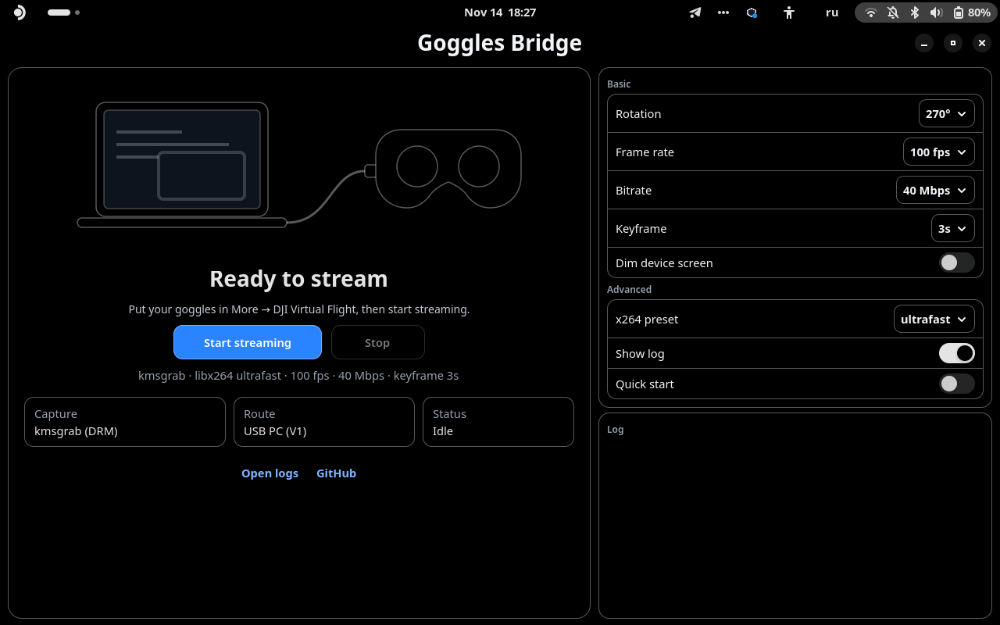

# GNU/Linux adaptation

This repository includes a GNU/Linux adaptation focused on low-latency streaming to DJI Goggles 2 / Integra over USB (Virtual Flight mode, stock firmware), with a GTK interface and Flatpak packaging.



### Functionality
- **Desktop streaming via `kmsgrab`** (KMS/DRM capture) encoded with `libx264` for a low-latency PC route.
- **Configurable stream settings:** rotation, FPS, bitrate, keyframe interval, and x264 preset.
- **Optional "Dim device screen"** mode to dim the device display while streaming and restore brightness on stop.
- **GTK UI:** start/stop streaming, view logs, open log/GitHub links, and manage settings.
- **Flatpak packaging:** manifests and metadata for local builds and Flathub-oriented submission (`flatpak/io.github.sevara_wind.G2Bridge.*`).

### CLI (Linux capture paths)
`scripts/stream_linux.py` reuses the same session, handshake and packetizer with Linux capture paths:

- **portal ScreenCast** through GStreamer/PipeWire (GNOME Wayland; no root);
- FFmpeg + VAAPI/libx264 for a test pattern, a video file, a V4L2 device or `kmsgrab`.

```bash
./setup_bazzite.sh
.venv/bin/python scripts/stream_linux.py --source desktop   # portal
.venv/bin/python scripts/stream_linux.py --source testsrc
.venv/bin/python scripts/stream_linux.py --source kmsgrab --kmsgrab-rotate 270 --encoder libx264 --preset ultrafast --fps 100 --bitrate-mbps 40 --keyframe-seconds 3
```

See [README_BAZZITE.md](README_BAZZITE.md) for Bazzite/Steam Deck installation, cable/host-mode notes, and troubleshooting. For Flatpak details see [`flatpak/README.md`](flatpak/README.md).

## Run tests

Run the tests from the repository root:

```powershell
python -m unittest discover -s tests -v
```

See the [video-delay measurement guide](docs/LATENCY.md), [PC protocol](docs/PROTOCOL.md), and [reverse-engineering data and tools](docs/research/README.md).
